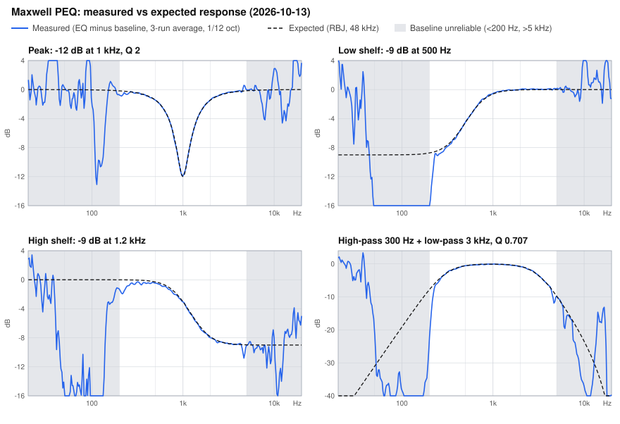

# Evidence record — 2026-10-12

Initial investigation target: original Audeze Maxwell PlayStation, direct USB interface VID `3329`, PID `4B1A`, usage page `FF13`. A `4B19` dongle was also present and was not used. The active built-in preset returned raw index `4`. That initial investigation only sent reads. Later live and persistent tests are recorded below.

## Coefficient generator

Inspected local `X:/audeze-re/extract/audeze-app/AirohaPeqLibrary.dll`, SHA-256 `322ac1149eeba9ed55f2466ba706edc92dcdb333cf574a6466abf88e4b3d50be`. The compiler refuses other hashes. The library is vendor code and is not included in this repository.

Disassembly of `set_peq_point` at `0x1800011C0` stores frequency, gain and width. In `generate_cofe`, `0x180002100` divides frequency by width; `0x180002115` doubles that result, and `0x180002119` divides sin(omega) by it. Thus width is linear bandwidth in Hz, **Q = frequency / width**, with alpha = sin(omega)/(2Q). Runtime comparisons confirm peaking-biquad behavior. Local assembly: `X:/audeze-re/analysis/peq-generate-full.asm`.

The independent reference follows the [W3C Audio EQ Cookbook](https://www.w3.org/TR/audio-eq-cookbook/) peaking filter equations. The initial 1 kHz / -3 dB / Q 1 filter had maximum sampled quantization error 0.0028624 dB across four banks. Changing Q changes width while preserving center gain. These are numerical checks, not acoustic measurements.

App packing function `0x1400152B0` creates banks `(1,44100)`, `(2,48000)`, `(5,88200)`, `(6,96000)`. Each has 103 little-endian 16-bit words: band count 10, ten stages of five signed coefficients stored high-word first, and one global scale. Fractional bits are `[31,30,31,30,31]` for `[b0,b1,b2,a1,a2]`; scale is Q26. Four-byte bank count plus four `(id:uint16,count:uint16,words)` records totals **844 bytes**.

## Exact reproduction of a saved headset preset

Read UI records from NVDM key `EF00` and saved coefficients from `E42C` (custom slot 0). Its ten frequencies were 32, 64, 125, 250, 500, 1000, 2000, 4000, 8000 and 16000 Hz; gains 3, 5, 7, 4, -4, -2, 3, 0, 5 and 0 dB; widths implied Q 2 throughout.

Recreating these with the vendor generator and the stock preset's zero global attenuation produced **844/844 matching bytes**, zero differences. Both blobs hash to `a6be633b31b7a5a04f4061ef2a93ca2609b1192bf47a09fc2e8917a7988a4194`. The normal UI compiler enforces additional headroom and precision requirements, so this comparison used the low-level vendor bank generator to reproduce stock settings exactly.

Local raw evidence is in ignored `artifacts/custom-slot0-read.json`, `artifacts/custom-slot0-coefficients.json` and `artifacts/stock-reproduction.json`. Device paths and raw snapshots stay local. Exact saved-byte recovery does not need the math DLL.

## Transport

RACE request: `05 5A`, little-endian length including the two-byte command, command, payload. Output HID report: `06`, chunk length, route byte, up to 59 packet bytes, padding to 62. Direct USB route is `00`. Responses use report ID `07`, with length at byte 1 and metadata at byte 2; assemble RACE packets by their declared length.

- Read current index: command `0901`, payload `0000`.
- Read saved records: command `0A0C`, key `EF00+slot` for UI or `E42C+slot` for coefficients, requested size 1000. Reply includes status, key, stored length and data.
- Custom raw indices 7-10 map to storage slots 0-3.
- Temporary live coefficients: command `0E03`, payload `00` followed by the 844-byte blob. Require exact success acknowledgement `05 5B 03 00 03 0E 00`.

App live function: `0x140024C10`. Saved-coefficient write function: `0x140024EF0` (command `0A0D`); implemented later with the restricted save/readback path described below. Protocol references are from local app disassembly and the supplied [balance/firmware tool source](https://github.com/kats1123/maxwell-balance-and-firmware-tool) at commit `16280b47fef610284beab5d40d46868d7b4c3253`.

## What remains unverified

Validation completed: 23 unit/integration tests passed with the vendor DLL present; JavaScript syntax check passed. Browser checks at 1280 px and 390 px verified rendering without page overflow, four compiled curves, stale-preview invalidation after Q edits, and a successful read of active built-in preset 4 with Apply disabled. Recovery tests use mocked workers, including pre-send preset changes, timeouts, restoration without recompilation and offline-mode gating.

Response outside 200 Hz–5 kHz and other firmware revisions remain unverified. The initial format checks have since been supplemented by the user listening test below. Peak filtering has listening confirmation on direct USB original PS hardware. Shelf/pass support has the numerical validation described below and a measured midband response. Every hardware result in this file is from the original Maxwell PlayStation; Xbox, Maxwell 2 and Maxwell 2 ANC remain untested (see the Maxwell 2 section at the end). Dongle testing, Bluetooth playback and preset switching, and a midband response measurement are recorded below.

## HID contention fix — 2026-10-12

A user Apply attempt failed with `RACE stream lost its packet boundary`. The server remained `unchanged`, meaning its worker reported failure before starting the live write. A read-only trace reproduced intermittent failure while `Audeze.exe` was running: parts of the saved-coefficient reply were missing, followed by HQ polling responses for unrelated commands. This supports competing readers consuming a shared device stream, not an invalid EQ coefficient blob.

After the user fully quit HQ, five consecutive full snapshots passed. The control handle now opens with sharing mode zero for the complete transaction; a sharing violation explicitly asks the user to quit HQ rather than permitting interleaved access. This follows [Windows CreateFile sharing semantics](https://learn.microsoft.com/en-us/windows/win32/api/fileapi/nf-fileapi-createfilea). Enumeration still uses metadata-only probes. No persistent write or live EQ was sent during this investigation.

Verification: all 25 tests passed. On the actual headset, a second read/write handle was rejected with Windows error 32 while the exclusive handle was open, and reopening after closing the first handle succeeded. The existing server loads the updated transport in each worker, so its in-memory backup was retained without a restart.

## User listening confirmation — 2026-10-12

After the contention fix, Aqua reported that temporary EQ audibly worked on the original Maxwell PlayStation. Adjusting Q produced a clearly audible change. With a 1,000 Hz tone generator and a very narrow -12 dB peaking filter centered at 1,000 Hz, the tone was clearly quieter.

This is user-reported end-to-end listening evidence for live peaking EQ and adjustable Q. It is not a calibrated measurement of exactly -12 dB or of the implemented bandwidth. A tone at the center demonstrates attenuation there; the reported change when varying Q provides separate evidence of bandwidth control. No custom firmware was required for these tests.

## Shelf and pass filter support — 2026-10-12

`set_xpf_point` at DLL VA `0x180001200` has ABI `(int context, int band, double frequency, double Q, int type)`. The generator's branches implement type 1 low-pass and type 2 high-pass. Offline calls at 1 kHz and Q sqrt(0.5) matched RBJ responses across all four rates within 0.00214 dB on the comparison grid. The application now calls this native function for pass filters; peak/pass-only sets retain the vendor generator.

The numeric format has **24 significant bits**, shifted left eight bits in the 32-bit wire value. Stage fractional bits are 23/22/23/22/23; global scale uses 18. DLL code at `0x18000347C` through `0x180003604` corroborates the global scale's 2^18 conversion and floor(x+0.5) rounding. The prior 31/30/26 descriptions specify the wire decode, not 32-bit generation precision.

Shelf-containing sets use `extended_filters.py`, with equations from the [W3C Audio EQ Cookbook](https://www.w3.org/TR/audio-eq-cookbook/). Shelves have fixed S=1. Each stage numerator is normalized by an analytical response bound and representable coefficient range; the first stage retains the vendor's 1.19 attenuation margin. The final scale compensates that normalization and applies preamp. Stage ordering/normalization are not byte-identical to the vendor's implementation. All generated banks are decoded and checked for stability, numerical accuracy and headroom before use.

Pass-filter resonance is included in automatic headroom analytically: for Q > sqrt(0.5), peak magnitude is Q/sqrt(1-1/(4Q^2)). Comparisons include the corresponding digital resonance frequency, DC and Nyquist. Error comparisons for experimental sets floor both responses at -90 dB; this avoids meaningless relative-dB errors at deep stopband nulls while still rejecting leakage above that floor. The 0.15 dB threshold remains: for example a 30 Hz, -6 dB low shelf is rejected for approximately 0.237 dB error, whereas a 100 Hz, +6 dB shelf passes at approximately 0.0363 dB.

Verification: 36 tests passed locally with the inspected DLL, including all new types, mixed cascades, shelf endpoint/midpoint properties, pass resonance, disabled filters, validation and a frozen SHA-256 check that the original peak preset remains byte-identical. Browser compilation returned four rate curves for all new filter types with appropriate gain/Q controls disabled. New filter types remain marked experimental; no new filter was sent to the headset during development.

## Dongle and persistent coefficient storage ? 2026-10-12

The original PS dongle uses VID `3329`, PID `4B19`, usage `FF13`, 62-byte HID reports and route byte `80`. An actual full snapshot through that interface returned current index 10 (Custom 4), its UI records and its 844-byte coefficient blob. The stored bytes matched the earlier USB backup exactly.

Static evidence comes from `Audeze.exe` SHA-256 `88299c36990f44de4ce17a5b9c65b5521fd68ee649fdb83e80ccf530ad604ca5` and the inspected stock PS v74 firmware. Local report: `X:/audeze-re/analysis/persistence/report.md`. The connected headset's firmware version remains unidentified; the stock firmware trace establishes implementation evidence, not its runtime version.

- App function `0x140024EF0` sends `0A0D`, a little-endian key `E42C + slot`, then the 844-byte coefficient blob. The RACE packet totals 852 bytes. Acknowledgement contains status and the same key.
- `0A03` with payload `4C03` is a capacity query for 844 bytes, not garbage collection. Firmware handler `0x081768E0` calls `0x081514F8` to read locked capacity counters; reply 1 means enough space and 0 means insufficient. The implementation never sends a reclaim/erase operation.
- Firmware `0A0D` handler `0x08176838` writes the key and compares readback. The editor independently reads the same key and requires every byte to match before reporting success or sending the live apply.
- Static reload code follows E401 phase 0 to E402. Presets 7?10 map phase 0 to E42C?E42F. Functions `0x081A5982`, `0x081A59FC`, `0x081A5A1E`, `0x081A5A2A` and `0x081A5A9C` select and load these coefficients through `0x081A4C68`. This path does not regenerate coefficients from the EF00?EF03 slider records. It supports coefficient-only persistence; runtime reboot validation is a separate check.

The API adds `/api/save` and `/api/restore_saved`. An immutable original backup is separate from the expected current stored state. Before each write, the server atomically journals the pending operation, original backup and desired bytes. Restart recovers that session. Save/Apply are disabled after uncertain writes; explicit saved restoration can repair mismatched stored coefficients while requiring the same interface, slot and UI records. Restore does not depend on the math DLL.

Hardware save test: with the user's authorization, the editor saved two peaks (1,370 Hz, -12 dB, Q 0.35; 6,200 Hz, -12 dB, Q 0.7; automatic preamp 0 dB) through the dongle to Custom 4. Save ACK was `055b05000d0a002fe4`. All 844 saved bytes matched compiled SHA-256 `f53a4e499baec5c1c403e829137618b70eba3d76ca6225f486a5878947f17833`. The subsequent temporary-apply ACK was `055b0300030e00`. Original coefficients remain in the ignored backups directory, including the earlier USB backup and a fresh matching dongle backup. Raw results: `artifacts/dongle-first-read.json`, `artifacts/dongle-first-save.json`, `artifacts/obvious-persistence-compiled.json`.

Before saving, the old USB session's restoration was stopped before a write: one attempt encountered a stream-boundary error, and a fresh snapshot then detected a changed USB interface path. A new dongle snapshot matched the original stored data before creating the new backup. No failed persistent write occurred in this test.

Validation: 57 automated tests pass, including packet/key restrictions, capacity reply semantics, failed readback preventing live application, verified-save/live-failure recovery, explicit repair of a malformed stored blob, and recovery after server restart or worker timeout. JavaScript syntax passes. An actual server restart recovered the saved state, dongle selection, original backup and last filter JSON. Browser checks confirmed the saved-state message, enabled restoration, disabled fresh backup and no horizontal overflow at 1280 px. Acoustic response remains unmeasured. Aqua unplugged the headset USB cable, left the dongle connected, powered the headset off/on, and reported that the obvious EQ remained in wireless playback. A subsequent read-only snapshot confirmed Custom 4 still contained all 844 expected bytes with the same SHA-256. USB enumeration found no direct headset interface. No EQ was reapplied after reboot. This establishes stored-byte retention and user-reported audible wireless persistence on this headset; it is not an acoustic response measurement. Raw readback: `artifacts/dongle-post-reboot-read.json`.

The first post-reboot snapshot hit a packet-boundary error before any EQ write. A traced fresh read succeeded and showed leftover coefficient fragments and restart notifications. The transport now requires six consecutive empty polls (at least 50 ms) before sending a command, instead of trusting the first empty poll. Input that never settles aborts after 100 polls. Tests cover delayed fragments restarting that interval, malformed input, and the bounded abort. Three consecutive wireless snapshots with the updated drain matched the saved profile. This improves handling of delayed input; it does not claim to eliminate every possible transport failure.

## Bluetooth playback and preset switching — 2026-10-12

Aqua reported two listening checks on the original PS headset:

- **Bluetooth.** The saved EQ worked fully in Bluetooth playback. The editor has no Bluetooth transport; this confirms the headset applies its stored coefficients to the Bluetooth audio path, not that the app can connect over Bluetooth.
- **Preset switching.** In Audeze HQ, switching from preset 4 to a different preset played that preset unchanged from stock. Switching back to preset 4 brought back a custom EQ.

A read-only dongle snapshot afterwards (2026-10-13 02:08 UTC) contradicts the second result being the editor's EQ. Custom 4 held SHA-256 `60dad9fc…`, the original HQ-generated coefficients from the first backup, not the editor's last save (a 7,450 Hz high-pass, `e1992015…`). Neither the editor's session nor its audit records contain a write of `60dad9fc…` after that save. The likely cause is that Audeze HQ regenerates the slot's coefficients from its own slider records, which the editor leaves unchanged, when the preset is reselected. If so, the custom EQ heard after switching back was HQ's slider EQ. This is unconfirmed: it needs a save, a switch in HQ and a readback, in that order.

## Measured response — 2026-10-13

Aqua measured five live EQs on the original PS headset over the dongle with a Dayton iMM-6 measurement mic and REW sweeps. The setup was rough: the mic lay on a table with the headset face down on top of it, in a room with poor acoustics. The headset and mic were not moved at any point during the tests, so every EQ was measured in the same position as the baseline.

Each EQ was sent live (`0E03`, ACKed) through `device_worker.py`, and saved Custom 4 was left unchanged. Each condition had three sweeps, exported without smoothing. Analysis applied 1/12-octave power smoothing, power-averaged the three runs, subtracted the averaged flat baseline (a 0 dB peak), and compared the difference with RBJ biquads at 48 kHz. Subtracting the baseline cancels the mic, seal and driver response, provided nothing moves.

| EQ | Compiled SHA-256 | Error, 300 Hz–3 kHz (mean / RMS / max) | Spot check |
|---|---|---|---|
| Peak 1,000 Hz, -12 dB, Q 2 | `8b7886…` | 0.01 / 0.06 / 0.29 dB | -11.90 dB at 1 kHz (expected -12.00) |
| Low shelf 500 Hz, -9 dB | `49db29…` | 0.05 / 0.09 / 0.31 dB | -4.45 dB at 500 Hz (expected -4.50) |
| High shelf 1,200 Hz, -9 dB | `6a2007…` | -0.13 / 0.17 / 0.65 dB | -8.9 to -9.0 dB from 3–5 kHz |
| High-pass 300 Hz + low-pass 3 kHz, Q 0.7071 | `472d5f…` | -0.01 / 0.07 / 0.26 dB | -3.14 dB at 300 Hz, -3.01 dB at 3 kHz (both expected -3.01) |

Grey bands mark where the baseline is unreliable. Curves beyond the plot range are clipped to its edge.

The shelves used the experimental `extended-rbj` encoder; the peak and pass pair used the vendor DLL. Between 300 Hz and 3 kHz, all four match their expected curves within about 0.1–0.2 dB RMS. This is the first hardware confirmation of the shelf filters. The high shelf cut 0.3–0.5 dB more than expected from 300–700 Hz; this session cannot tell whether that comes from the encoder or the measurement.

Run-to-run spread of the baseline was 0.02–0.3 dB from 300 Hz to 5 kHz, but up to about 30 dB below 200 Hz and above 5 kHz, where seal leakage and noise dominate. Results outside 200 Hz–5 kHz are not usable, which is why the low-shelf and pass-filter bass regions read far below their expected curves. Bass and treble response remain unmeasured. Raw exports are in Aqua's `Documents/Maxwell Measurements`, not in the repository.

## Maxwell 2 and Maxwell 2 ANC — static analysis only

Nothing in this section has run on a Maxwell 2. It comes from Audeze HQ 1.2.48, analysed offline.

- `MaxwellHidApiClient::GetDevType` maps product IDs `4B18`–`4B27` to the original Maxwell, `4B28`–`4B2A` to Maxwell 2, and `4BA8` and up to Maxwell 2 ANC. `IsDongle` marks `4B18`/`4B19`, `4B28`/`4B29` and `4BA8`/`4BA9` as dongles. That `4B2A` is the Maxwell 2 over USB-C is an inference from those ranges.
- `MaxwellDeviceImpl::Impl::setEqBands` calls the same `MaxwellTransport::writeEqBands` for every model: live `0E03`, the UI records, then the coefficients to `E42C+slot`.
- For Maxwell 2 not on a dongle, `setEqBands` then sends voice-prompt level 0 (`05 5A 05 00 00 09 20 00 00`), selects the cached current preset (`05 5A 05 00 00 09 00 00 <index>`), sleeps 1,000 ms, and restores the cached voice-prompt level. The app reads the level first (`05 5A 04 00 01 09 20 00`), runs the same sequence after each verified save over USB-C, and checks the preset afterwards. These three commands are allowed only with the save capability, and the preset value only for custom presets 7–10.
- HQ reads Maxwell 2 ANC EQ through a separate path (`readUserBiquad`, `BytesToMaxwell2AncEq`, its own cache). The app treats product IDs `4BA8`–`4BAF` as ANC and refuses them before any EQ command.

Unknowns: whether Maxwell 2 accepts the original's 844-byte four-rate coefficient blob and encoder output byte for byte, whether live EQ on a Maxwell 2 over USB-C is audible before a save, and whether its balance settings use the same subcommands. Balance is therefore limited to the original Maxwell.
